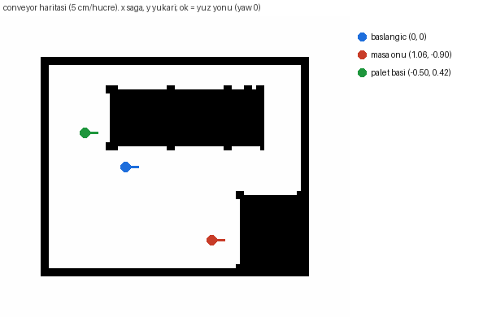
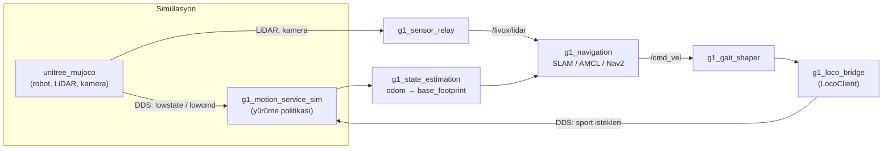

# G1 Basic — Simülasyon, Yürüme, Nav2 ve Conveyor Dünyası

Unitree G1 insansı robotu (29 serbestlik derecesi, RH56E2 eller) için ROS 2 Humble tabanlı bir
yazılım yığınının **temel sürümü**. Robot MuJoCo simülasyonunda, gerçek robotla aynı DDS
topic'lerini konuşarak çalışır; yürür, haritasını çıkarır, kendini haritada bulur ve Nav2 ile
verilen hedefe kendi gider.

Bu dal, sistemi incelemek isteyenler için hazırlandı. İçinde **simülasyon, yürüme ve navigasyon**
var; nesne algılama (perception), kol ile manipülasyon (pick & place), MoveIt ve görev
orkestrasyonu bu sürümde **yok**.

| Var | Yok |
|---|---|
| MuJoCo simülasyonu (Mid360 LiDAR ve kafa kamerası simüle) | Nesne algılama / takip |
| Öğrenilmiş yürüme politikası, LocoClient köprüsü | Kol ile pick & place |
| SLAM Toolbox ile harita çıkarma | MoveIt planlama |
| AMCL ile haritada konum bulma | Davranış ağacı ile görev akışı |
| Nav2 ile hedefe gitme | |
| Tesis dünyası ve conveyor hattı dünyası | |

## Dünyalar

| `world:=` | Ne var | Harita |
|---|---|---|
| `navigation` (varsayılan) | Dört odalı tesis: raflar, çalışma tezgâhı, kolonlar, rampa | `facility` |
| `conveyor_fixed` | Conveyor hattı odası: BSH panelli masa, bant, bant üzerinde palet | `conveyor` |
| `conveyor`, `conveyor_flat`, `conveyor2` | Aynı oda; masadaki parçalar farklı | `conveyor` |

Harita dünyaya göre otomatik seçilir; `map:=<dosya.yaml>` ile değiştirilebilir. Conveyor odası
dar olduğu için orada Nav2 robotu 0.45 m yerine 0.22 m yarıçaplı sayar
(`g1_navigation/config/nav2_world_conveyor.yaml`). Conveyor haritası sahnenin geometrisinden
üretilmiştir (LiDAR'ın gördüğü 0.30–1.50 m yükseklik bandı):



## Kurulum

Gereken: Ubuntu (ana makine), Docker Engine + Docker Compose v2, NVIDIA sürücüsü ve NVIDIA
Container Toolkit, `vcstool` (`python3 -m pip install --user vcstool`). Arayüzlü modlar için X11
masaüstü oturumu.

ROS tarafının hepsi geliştirme konteynerinin içinde çalışır (Ubuntu 22.04 + ROS 2 Humble; Unitree
SDK'sının istediği ikili bu).

```bash
git clone -b merts-g1-basic https://github.com/Mertsr/g1-dex5-mujoco g1-basic
cd g1-basic
cp .env.example .env
./scripts/import-externals.sh      # workspace.repos'taki üçüncü parti paketleri çeker
./scripts/manage.sh start          # imajı kurar (simülatör dahil) ve konteyneri başlatır
./scripts/manage.sh exec           # konteynerde kabuk açar
```

Konteynerin içinde derleme:

```bash
cd /root/workspace
colcon build --symlink-install --cmake-args -DCMAKE_BUILD_TYPE=RelWithDebInfo
source install/setup.bash
```

## Çalıştırma

Tek giriş noktası `g1_bringup/bringup.launch.py`:

```bash
# Sadece simülatör, MuJoCo penceresi açık
ros2 launch g1_bringup bringup.launch.py headless:=false

# Conveyor dünyası: haritada konum bul + Nav2, RViz ve MuJoCo penceresi açık
ros2 launch g1_bringup bringup.launch.py \
  world:=conveyor_fixed mode:=localization nav:=true rviz:=true headless:=false

# Tesis dünyası: aynı şey
ros2 launch g1_bringup bringup.launch.py mode:=localization nav:=true rviz:=true

# Yeni harita çıkarmak (robotu gezdirip map_saver_cli ile kaydet)
ros2 launch g1_bringup bringup.launch.py world:=conveyor_fixed mode:=mapping rviz:=true
```

| Argüman | Varsayılan | Anlamı |
|---|---|---|
| `world` | `navigation` | Hangi dünya (yukarıdaki tablo) |
| `mode` | `none` | `none`: sadece simülatör. `mapping`: SLAM ile harita çıkarır. `localization`: kayıtlı haritada AMCL ile konum bulur |
| `nav` | `false` | Nav2'yi başlatır; `mode:=localization` ister |
| `map` | boş | Konum bulmada kullanılacak harita; boşsa dünyanın kendi haritası |
| `rviz` | `false` | RViz'i açar (navigasyon modlarında harita, costmap ve planla) |
| `headless` | `true` | `false` MuJoCo penceresini açar |
| `walk_policy` | `walker` | Yürüme politikası: `walker` veya `isaaclab` |
| `odometry` | `sportmodestate` | `sportmodestate`: simülatörden kusursuz odometri. `fast_lio`: gerçek robottaki LiDAR-ataletsel odometri |

### Robotu bir hedefe göndermek

RViz'deki **2D Goal Pose** aracıyla haritaya tıklamak yeterli. Komut satırından:

```bash
# Conveyor dünyası: masanın önü (görseldeki kırmızı nokta)
ros2 action send_goal /navigate_to_pose nav2_msgs/action/NavigateToPose \
  "{pose: {header: {frame_id: map}, pose: {position: {x: 1.06, y: -0.90}, orientation: {w: 1.0}}}}"

# Conveyor dünyası: paletin başı (yeşil nokta)
ros2 action send_goal /navigate_to_pose nav2_msgs/action/NavigateToPose \
  "{pose: {header: {frame_id: map}, pose: {position: {x: -0.50, y: 0.42}, orientation: {w: 1.0}}}}"

# Tesis dünyası
ros2 action send_goal /navigate_to_pose nav2_msgs/action/NavigateToPose \
  "{pose: {header: {frame_id: map}, pose: {position: {x: 2.5, y: -2.5}, orientation: {w: 1.0}}}}"
```

Robot dünyanın orijininde (0, 0) başlar ve AMCL'nin başlangıç konumu da odur; ek bir ayar
gerekmez.

### Robotu elle yürütmek

```bash
ros2 action send_goal /g1_loco_bridge/set_mode g1_msgs/action/SetLocoMode "{fsm_id: 4}"    # ayağa kalk
ros2 action send_goal /g1_loco_bridge/set_mode g1_msgs/action/SetLocoMode "{fsm_id: 500}"  # yürümeye başla
ros2 run teleop_twist_keyboard teleop_twist_keyboard --ros-args \
  -r /cmd_vel:=/g1_loco_bridge/cmd_vel -p speed:=0.6 -p turn:=1.57
```

`speed` ve `turn` değerleri önemli: varsayılanlar yürüyüşün ölü bölgesinde kalır ve robot
kıpırdamaz.

## Mimari



Simülatör, gerçek robotla aynı DDS topic'lerini kullanır; gerçek robota geçişte simülasyon kartı
robotun kendi hareket servisiyle, LiDAR ön ucu `livox_ros_driver2` ile yer değiştirir, üstteki her
şey aynı kalır. Tasarımın iki kuralı:

- Bir alt seviye kanala her zaman tek bir yayıncı komut verir; kontrol sahipliği açıktır.
- Kol hareketi `rt/arm_sdk` üzerinden, robotun kendi denge kontrolcüsüyle harmanlanarak gider;
  ham `/lowcmd` göndermek dengeyi üstlenmek demektir.

## Paketler

| Paket | Görevi |
|---|---|
| [`g1_bringup`](workspace/src/g1_bringup) | Giriş noktası: launch dosyaları, sahneler (MJCF), ayarlar, conveyor araçları |
| [`g1_description`](workspace/src/g1_description) | G1 URDF'i (RH56E2 ellerle) ve `ros2_control` sarmalayıcısı |
| [`g1_motion_service_sim`](workspace/src/g1_motion_service_sim) | Robotun yerleşik hareket servisinin simülasyon karşılığı; yürüme politikasını çalıştırır |
| [`g1_locomotion`](workspace/src/g1_locomotion) | LocoClient köprüsü, yürüyüş şekillendirici, hareket yetkisi |
| [`g1_navigation`](workspace/src/g1_navigation) | SLAM Toolbox, AMCL, Nav2 ayarları ve haritalar |
| [`g1_sensor_relay`](workspace/src/g1_sensor_relay) | Simülatörde örneklenen LiDAR ve kamera verisini ROS'a yayınlar |
| [`g1_state_estimation`](workspace/src/g1_state_estimation) | `odom → base_footprint` ve Nav2'nin istediği TF zinciri |
| [`g1_hardware_interface`](workspace/src/g1_hardware_interface) | Kol eklemlerini `rt/arm_sdk`'ya bağlayan `ros2_control` eklentisi |
| [`g1_hand_interface`](workspace/src/g1_hand_interface) | El için `ros2_control` eklentisi |
| [`g1_msgs`](workspace/src/g1_msgs) | `SetLocoMode`, `ApproachObject`, `Retreat` aksiyonları ve `LocoStatus` mesajı |

Her paketin kendi README'si (İngilizce) ayrıntıları, ölçümleri ve testleri anlatır.

## Testler

```bash
colcon test --packages-select g1_description g1_locomotion g1_navigation
colcon test-result --all
```

Simülatör başlatan testler zamanlamaya duyarlıdır ve `simulator` etiketi taşır:

```bash
colcon test --ctest-args -LE simulator   # simülatörsüz testler
colcon test --ctest-args -L  simulator   # sadece simülatörlü testler (paket paket çalıştırın)
```

Önceki bir çalıştırmadan kalan düğümler hayalet hatalara yol açar; önce temizleyin:

```bash
./scripts/clean-stack.sh
```

## Depo yapısı

```
.devcontainer/      geliştirme imajı (simülatör dahil)
workspace/src/      ROS 2 paketleri
workspace/patches/  simülatöre imaj kurulurken uygulanan yamalar
workspace/vendor/   simülatöre derlenen kendi kodumuz (sensörler, conveyor, el kaynağı)
scripts/            konteyner yönetimi ve yığını temizleme
docs/               README görselleri
```

## Lisans

[grove-g1](https://github.com/Adyansh04/grove-g1) temel alınmıştır; BSD-3-Clause (bkz. `LICENSE`).
